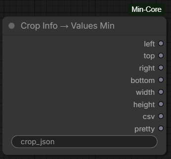

# Crop Info → Values Min

Crop Info → Values Min is a companion to [Drag Crop Min](drag_crop.md). Connect
Drag Crop Min's **CROP_JSON** output to **crop_json** to get the crop offsets
and dimensions as separate values, or as formatted text for other nodes.

## Credits

This node is a port of [ComfyUI-Olm-DragCrop](https://github.com/o-l-l-i/ComfyUI-Olm-DragCrop)
by [o-l-l-i](https://github.com/o-l-l-i).

For crops from Drag Crop Min, **left**, **top**, **right**, and **bottom** are
pixel amounts removed from each side of the source image. In particular,
**right** and **bottom** are margins, not the crop's ending x/y coordinates.

## Inputs

- **crop_json** (STRING) — JSON containing crop information, typically from
  Drag Crop Min's **CROP_JSON** output.

## Outputs

- **left**, **top**, **right**, **bottom**, **width**, **height** (INT) — crop
  offsets and dimensions, in pixels.
- **csv** (STRING) — values in `left,top,right,bottom,width,height` order.
- **pretty** (STRING) — a labeled summary, such as
  `left=10, top=20, right=30, bottom=40, width=500, height=400`.

If the input is empty or invalid JSON, the node uses zero values for the
coordinates and dimensions.
