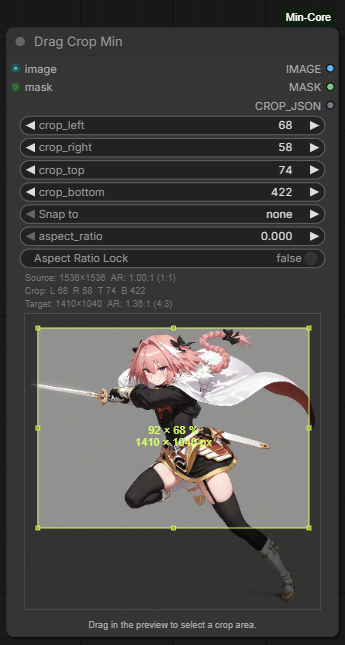

# Drag Crop Min

Drag Crop Min lets you select a crop directly on the input image preview. Drag
in the preview to create a selection, drag inside the box to move it, or drag
its edges and handles to resize it. The area outside the selection is dimmed;
the preview also shows the crop offsets and target dimensions. Run the workflow
to produce the cropped outputs.

The crop is measured in pixels of the source image. If the input image's
resolution changes, the selection resets to the full image. The crop selection
and widget settings are part of the node in the workflow; no separate crop file
is created.

## Credits

This node is a port of [ComfyUI-Olm-DragCrop](https://github.com/o-l-l-i/ComfyUI-Olm-DragCrop)
by [o-l-l-i](https://github.com/o-l-l-i).

## Inputs

- **image** (IMAGE) — source image to crop.
- **mask** (MASK, optional) — mask cropped to the same region as the image. If
  no mask is connected, the node returns a zero-filled mask with the crop's
  dimensions.
- **aspect_ratio** (FLOAT, default `0`) — width-to-height ratio for the crop.
  Set it to `0` for no ratio constraint; for example, use `1.777` for a wide
  crop. It can also be connected to a FLOAT input.
- **crop_left**, **crop_right**, **crop_top**, **crop_bottom** — pixel amounts
  cropped from each corresponding side of the source. These values update as
  you edit the selection and can also be entered directly.
- **Snap to** — when enabled, rounds the crop width and height to the selected
  pixel increment (`2`, `4`, `8`, `16`, `32`, or `64`). The default `none`
  leaves dimensions unsnapped.
- **Aspect Ratio Lock** — off by default. When on and `aspect_ratio` is
  greater than zero, creating or resizing the box keeps the specified
  width-to-height ratio. A connected `aspect_ratio` value is reflected in the
  widget when the node runs with the lock enabled.

## Outputs

- **IMAGE** — the selected region of the source image.
- **MASK** — the corresponding region of the input mask. If no mask is
  connected, this is a zero-filled mask matching the crop dimensions.
- **CROP_JSON** — a JSON string with `left`, `top`, `right`, `bottom`, `width`,
  and `height`, plus the original and cropped sizes. `left`, `top`, `right`,
  and `bottom` are pixel amounts removed from those sides; `right` and `bottom`
  are margins, not the crop's ending x/y coordinates.

To split **CROP_JSON** into individual values or formatted text, connect it to
[Crop Info → Values Min](crop_info.md).
