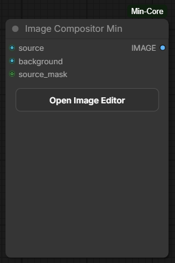
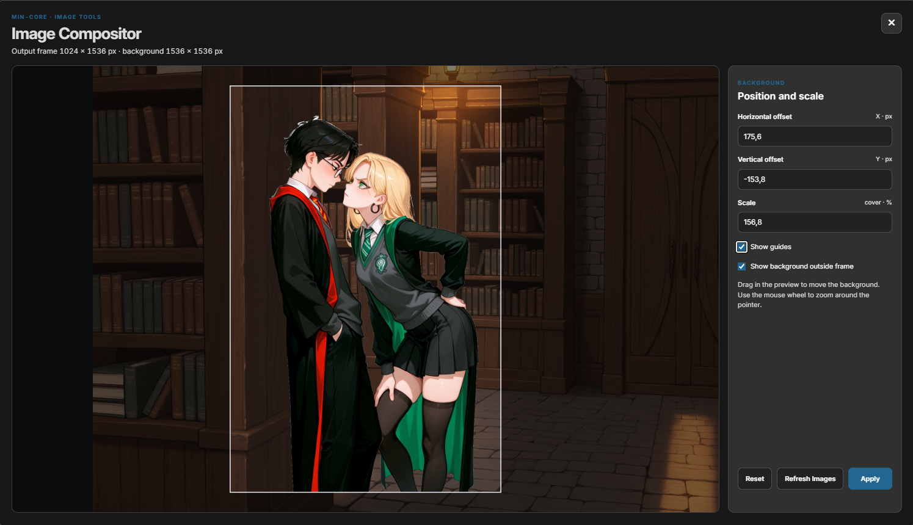

# Image Compositor Min

Place a foreground image over a movable, resizable background. The foreground
stays fixed and sets the output size; the background is positioned to fill it.
Use **Open Image Editor** to adjust the background, then click **Apply**.

## Inputs

- **source** (IMAGE) — foreground; defines the output dimensions.
- **background** (IMAGE) — image shown behind the foreground.
- **source_mask** (MASK, optional) — makes parts of the foreground transparent;
  **1** means transparent, as with masks from **Load Image**.

## Outputs

- **IMAGE** — the composite, with the same dimensions as `source`.
