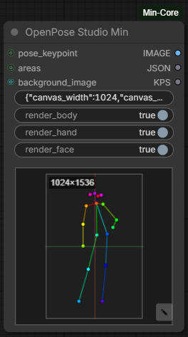
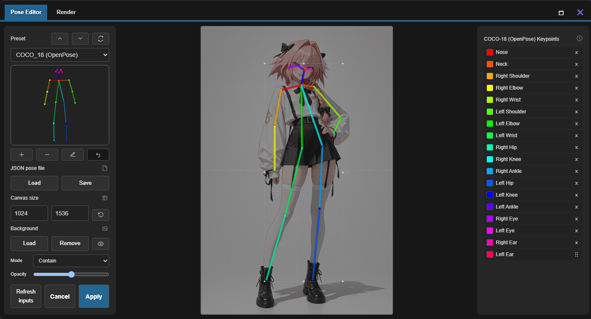

# OpenPose Studio Min

OpenPose Studio Min lets you edit a human pose in ComfyUI and outputs a rendered
pose image, JSON, and `POSE_KEYPOINT` data for compatible downstream nodes.

Click the node preview or choose **Open in Editor** from its context menu.

Choose a preset or load a pose JSON file, then edit the keypoints on the canvas.
Right-click a keypoint to hide it from the pose; it is treated as a missing point
in the outputs.
**Apply** saves the pose with the workflow and runs the node; **Cancel** discards
the current edits. **Refresh inputs** re-runs this node and its upstream dependencies
without closing the editor. If `pose_keypoint` is connected, it takes precedence
over `pose_json` during execution.

The **Render** tab changes the appearance of the final IMAGE. A background image
is only an editing reference; it is not included in the output.

## Credits

Based on [ComfyUI-OpenPose-Studio](https://github.com/andreszs/comfyui-openpose-studio)
by andreszs.

## Keyboard shortcuts

- **Ctrl/Cmd+Z** — Undo; **Ctrl/Cmd+Shift+Z** or **Ctrl/Cmd+Y** — Redo.
- **↑ / ↓** — Previous / next preset.
- **Delete** — Remove selected keypoints, or the selected pose if no keypoints
  are selected.
- **Esc** — Exit hand-edit mode, or close the editor and discard unapplied edits.

Shortcuts are inactive while typing in an input or selecting a dropdown value.

## Inputs

- **pose_json** (STRING, default: `""`) — Pose data to edit or render. A
  connected `pose_keypoint` input overrides this value.
- **render_body** (Boolean, default: `true`) — Show the body skeleton. When off,
  IMAGE is black and KPS contains no people.
- **render_hand** (Boolean, default: `true`) — Show and include hand keypoints.
- **render_face** (Boolean, default: `true`) — Show and include face keypoints.
- **pose_keypoint** (POSE_KEYPOINT, optional) — Pose data from compatible nodes,
  such as DWPose.
- **areas** (CONDITIONING_AREAS, optional) — Shows conditioning-area guides in
  the editor only; does not affect the outputs.
- **background_image** (IMAGE, optional) — Editor reference image. The canvas
  resizes to its dimensions, scaling existing keypoints; the image is not part of
  IMAGE output.

## Outputs

- **IMAGE** — Rendered pose on a black background. With no pose, returns a black
  512×512 image.
- **JSON** — Pose JSON. The render toggles remove the corresponding body, hand,
  or face data.
- **KPS** (POSE_KEYPOINT) — Canvas dimensions and per-person pose data for
  compatible downstream nodes. When no usable pose is available, it contains no
  people.

The node supports COCO-17 and COCO-18 poses for rendering; COCO-17 poses cannot
currently be edited in the editor. Render style and locally loaded backgrounds
are stored in the browser, not in the workflow.
